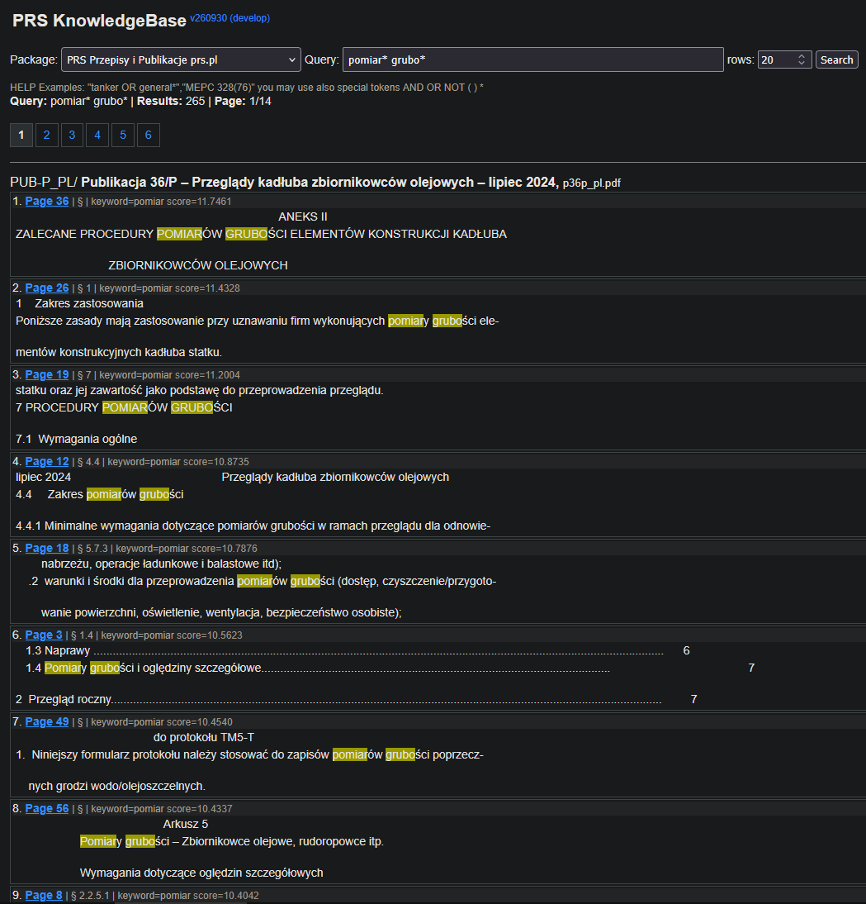

<main>

# Rules Search v2 eval
_12.10.2026 pb_

## UI / bugi

### Metadane

Nadpisanie pliku PDF 

### Fatal error

Czasami przy klikaniu WSTECZ (np. jeśli wybraliśmy upload_url, a potem jednak rezygnujemy) pojawia się komunikat:
```
Fatal error: Uncaught ValueError: Path cannot be empty in E:\dr_prs_pl_htdocs\search\.www\explorer.php:1732 Stack trace: #0 E:\dr_prs_pl_htdocs\search\.www\explorer.php(1732): fopen('', 'rb') #1 E:\dr_prs_pl_htdocs\search\.www\explorer.php(2104): FileManager->uploadFromUrl('', '') #2 E:\dr_prs_pl_htdocs\search\.www\explorer.php(3331): FileManager->run_fm(Object(Location)) #3 E:\dr_prs_pl_htdocs\search\dms.php(2): include_once('E:\\dr_prs_pl_ht...') #4 {main} thrown in E:\dr_prs_pl_htdocs\search\.www\explorer.php on line 1732
```

Adres URL to wtedy:
```
https://dr.prs.pl/search/dms.php?dir=
```

### Document expired

Często po kliknięciu wstecz w przeglądarce pojawia się błąd:

```
Document Expired

The requested document is not available in Firefox’s cache.
```

Towarzyszy mu zwykle adres:
```
https://dr.prs.pl/search/dms.php
```

Kilkukrotne wciśnięcie wstecz pozwala wrócić do poprzedniego menu.

Ogólnie brakuje `Wstecz` jako takiego zawartego w UI strony.

## Wyszukiwanie

### Wiele wyników w jednym pliku

W sytuacji gdy znalezionych jest wiele rekordów w jednym pliku, wyszukiwarka wyświetla je wszystkie. Czasami trzeba przejść na kolejną stronę, żeby się przez nie przebić. W starej wyszukiwarce rekordy były agregowane (jeśli dostatecznie blisko siebie) i sortowane globalnie, a nie w obrębie jednego pliku; dzięki temu można było przejrzeć najwazniejsze wyniki z różnych plików dość szybko.

Dobrze rozwiązane to jest w wyszukiwarce *recoll*. Wyszukania z każdego pliku są agregowane w jeden rekord i wyświetlone jeden po drugim jako blok tekstu. Na każdy plik przypada tylko jeden blok. Po kliknięciu w niego przechodzi się do podstrony zawierającej szczegóły wyszukania w danym pliku --- *snippets* (fragmenty) oraz odpowiadające im strony w pliku PDF.

Nowa wyszukiwarka:



Stara wyszukiwarka:


### Line break

Klasyczny problem, który rozwiązaliśmy w starej wersji przeglądarki, a w nowej jeszcze nie. 

</main>